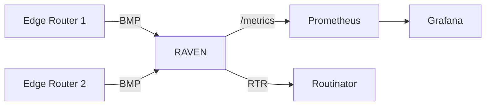

# Production Setup

This guide covers deploying RAVEN in a production environment against real
routers and a production RPKI validator.

## Architecture



## Step 1 — Install RAVEN

On the monitoring host:

```bash
go install github.com/nokia/bgp-routing-security-monitor/cmd/raven@latest
```

Or download a pre-built binary from the
[releases page](https://github.com/nokia/bgp-routing-security-monitor/releases)
and place it in `/usr/local/bin/`.

## Step 2 — Create the Config File

```bash
sudo mkdir -p /etc/raven
```

Create `/etc/raven/raven.yaml`:

```yaml
bmp:
  listen: "0.0.0.0:11019"
  allowed-routers:                  # your routers' BMP source addresses
    - 192.0.2.10
    - 192.0.2.11

rtr:
  caches:
    - address: "rpki-validator.example.com:3323"
      preference: 1
    - address: "rpki-validator-backup.example.com:3323"
      preference: 2
  rtr-version: auto

validation:
  rov: true
  aspa: true
  aspa-default-procedure: upstream
  aspa-peers:                       # map your transit providers
    - address: 198.51.100.1
      neighbor-role: provider

outputs:
  prometheus:
    listen: "0.0.0.0:9595"          # firewall to your Prometheus servers
    path: "/metrics"

api:
  listen: "127.0.0.1:11020"         # the default; run the CLI on this host

logging:
  level: info
  format: json
```

Before you start RAVEN, work through
[Deployment Hardening](hardening.md): it covers the host firewall rules for
the BMP and metrics ports and how to reach the API from another machine.
