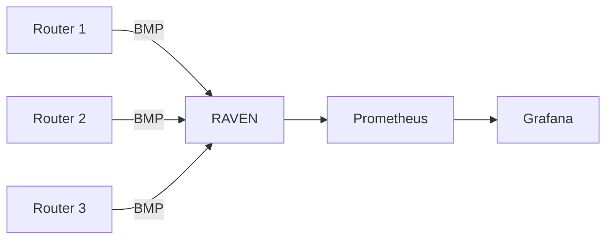
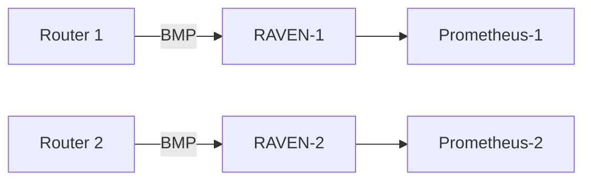
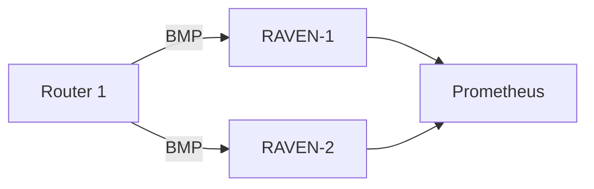

# Scaling

RAVEN is designed as a single-binary, single-instance tool for most deployments.
This page covers capacity planning and multi-instance patterns for larger
environments.

## Single Instance Capacity

A single RAVEN instance on modest hardware handles:

| Scenario | Routes | RAM | CPU |
|---|---|---|---|
| Small network, 1-2 routers, partial table | ~100K routes | ~512MB | minimal |
| Medium network, 5 routers, full DFZ | ~5M routes | ~4GB | 1-2 cores |
| Large network, 10+ routers, full DFZ per router | ~120M routes | ~16GB | 4 cores |

The memory target for a full-table multi-router deployment is under 16GB RSS.
RAVEN uses a compressed prefix trie (BART) for memory-efficient route storage.

## Sizing Guidelines

**RAM:**
The dominant factor is the number of routes in the Route Table. Each route
object is approximately 512 bytes. Budget 1GB RAM per 1M routes, plus 2GB
baseline for the RPKI cache and process overhead.

**CPU:**
RAVEN is designed for high throughput on the BMP ingestion hot path. During
initial table dump (when routers first connect), CPU usage spikes briefly then
settles to near-zero for steady-state operation. Use 4 cores for large
deployments.

**Network:**
BMP is TCP — kernel flow control handles backpressure naturally. No special
network sizing needed beyond reliable connectivity between routers and the
RAVEN host.

**Disk:**
RAVEN is stateless by default — no disk I/O in steady state. If you enable
file output (NDJSON logging), size accordingly.

## Reducing Memory Usage

If you do not need full pre-policy visibility, configure your routers to send only post-policy BMP. For FRR:

```text
bmp targets raven
monitor ipv4 unicast post-policy
monitor ipv6 unicast post-policy
exit
```

Post-policy tables are significantly smaller than pre-policy since import
policies filter out many routes before installation. RAVEN stores them, but
route queries and status totals without `--rib` show the default view,
pre-policy and Loc-RIB; use `raven routes --rib adj-rib-in-post` to list
them.

A router's Loc-RIB (RFC 9069) is smaller still: one best path per prefix,
however many peers sent it, instead of one table per peer. RAVEN shows it
in the default view, and it also covers the router's own and iBGP-learned
routes. See [Loc-RIB Monitoring](../user-guide/loc-rib.md).

## Multiple Routers, Single RAVEN Instance

The recommended pattern for most networks is one RAVEN instance receiving BMP from all your routers:



RAVEN handles concurrent BMP sessions with one goroutine per session.
There is no practical limit on the number of BMP sessions a single instance
can accept beyond the RAM budget for the combined route table.

## Filtering at the Router

For very large deployments, reduce the route table size by filtering BMP exports at the router. For FRR, send only routes from specific peers:

```text
bmp targets raven
monitor ipv4 unicast pre-policy
neighbor 192.0.2.1 bmp
neighbor 192.0.2.2 bmp
exit
```

This is useful when you want to focus RAVEN on specific peering sessions
rather than your full BGP table.

## High Availability

RAVEN is a passive observability tool — it has no role in the data plane.
A RAVEN outage does not affect routing. Design for availability based on
your monitoring SLA, not routing resilience requirements.

**Simple HA pattern: two independent instances**



Run two RAVEN instances receiving from different sets of routers. Aggregate
in Prometheus using federation or a shared remote write target. This gives
you redundancy without coordination complexity.

**Full redundancy: all routers to both instances**



Both instances receive the full route table independently. Prometheus
aggregates via federation. Use different job labels to distinguish instances.
Metrics will be duplicated — use `max()` or `avg()` in your PromQL queries
rather than `sum()`.

## Multiple RTR Caches

Always configure a backup RTR cache:

```yaml
rtr:
  caches:
    - address: "routinator-primary.example.com:3323"
      preference: 1
    - address: "routinator-backup.example.com:3323"
      preference: 2
```

If the primary cache goes down, RAVEN automatically fails over to the backup
and logs a warning. The `raven_rtr_session_state` metric will show 0 for the
failed cache — alert on this.

## RTR Data Freshness

RAVEN keeps validating with the last data a cache sent, even when that cache
stops syncing. Stale RPKI data validates routes against ROAs and ASPA
records that may since have changed, so alert on freshness rather than only
on the session state. Three per-cache metrics cover it:

| Metric | What it tells you |
|---|---|
| `raven_rtr_data_expired` | 1 when no sync with the cache has completed within its Expire Interval, the time the cache says its data stays usable. RAVEN takes it from the cache's End of Data PDU, or uses 7200 seconds when the cache sends none |
| `raven_rtr_last_sync_seconds` | Unix time of the last completed sync (End of Data), whether or not the data changed |
| `raven_rtr_last_serial_change_seconds` | Unix time of the last sync that changed the serial |

```yaml
- alert: RAVENRTRDataExpired
  expr: raven_rtr_data_expired == 1
  for: 5m
  labels:
    severity: critical
  annotations:
    summary: "RAVEN RTR data has expired — validation data may be outdated"

- alert: RAVENRTRNoRecentSync
  expr: time() - raven_rtr_last_sync_seconds > 1800
  for: 5m
  labels:
    severity: warning
  annotations:
    summary: "No completed RTR sync with {{ $labels.cache }} in 30 minutes"
```

`raven_rtr_data_expired` follows the cache's own Expire Interval, so it
fires late by design. The second rule catches a cache that stopped syncing
well before then; set its threshold to a few multiples of your cache's
refresh interval.

## Querying a Remote RAVEN Instance

The RAVEN CLI can query any RAVEN instance whose API it can reach. The API
binds to loopback by default, so either open an SSH tunnel to the instance
or set [`api.listen`](../user-guide/configuration.md#api-section) on it to a
management address and firewall that port (see
[Deployment Hardening](hardening.md#keep-the-api-on-loopback)). Then:

```bash
raven routes --address 192.0.2.10:11020 --posture origin-invalid
raven status --address 192.0.2.10:11020
raven what-if --address 192.0.2.10:11020 --reject-invalid
```

This is useful for operations teams who want CLI access without running a
local RAVEN instance.

## Prometheus Federation

When running multiple RAVEN instances, aggregate metrics via Prometheus
federation:

```yaml
# Central Prometheus
scrape_configs:
  - job_name: raven-federation
    honor_labels: true
    metrics_path: /federate
    params:
      match[]:
        - '{job="raven"}'
    static_configs:
      - targets:
          - "prometheus-1.example.com:9090"
          - "prometheus-2.example.com:9090"
```
