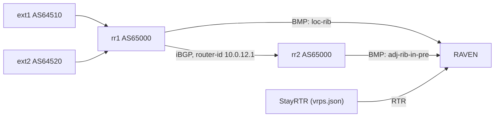

# Loc-RIB Lab

`lab/loc-rib/` in the code repository is a small Containerlab topology that
checks [Loc-RIB monitoring](../user-guide/loc-rib.md) (RFC 9069) live,
against real FRR routers. It is a test lab, not a demo: `run.sh` deploys
it, runs its checks and reports PASS or FAIL for each.

It checks that RAVEN stores a router's Loc-RIB apart from the Adj-RIB-In
views, lists it in the default view, validates a locally originated route
with the router's own AS as its origin, and withdraws Loc-RIB routes
correctly.

## Topology



| Node | Image | Role |
|---|---|---|
| `rr1` | `quay.io/frrouting/frr:10.7.1` | Exports its Loc-RIB to RAVEN (BMP from `172.31.90.21`). Rejects `10.99.0.0/24` from ext1 on import and originates `10.65.0.0/24` itself |
| `rr2` | `quay.io/frrouting/frr:10.2.5` | iBGP to rr1 on `10.0.12.1`; exports the pre-policy Adj-RIB-In of that session to RAVEN (BMP from `172.31.90.22`) |
| `ext1` | `quay.io/frrouting/frr:10.2.5` | AS64510; announces `203.0.113.0/24`, `198.51.100.0/24`, `192.0.2.0/24` and `10.99.0.0/24` |
| `ext2` | `quay.io/frrouting/frr:10.2.5` | AS64520; announces `203.0.113.0/24` with a longer path (`64520 64510`) |
| `raven` | `alpine:latest` | The RAVEN binary built from your checkout |
| `rtr` | `rpki/stayrtr:latest` | Serves four ROAs from `vrps.json`: `203.0.113.0/24` for AS64510 (Valid), `198.51.100.0/24` for AS64999 (Invalid), `10.99.0.0/24` for AS64510, and `10.65.0.0/24` for AS65000, rr1's own prefix. `192.0.2.0/24` has none (NotFound) |

The lab uses its own addresses and AS65000, as its configuration files
have them. rr1's Loc-RIB is the peer `0.0.0.0` (type `loc-rib`) on router
`172.31.90.21`, and rr2's view of rr1 is the peer `10.0.12.1` (type
`global`) on router `172.31.90.22`. rr1's router-id is also the address
rr2 peers with, so the lab also checks that the two views stay apart.

rr1 is pinned to FRR 10.7.1 because the checks depend on how FRR's BMP code
handles the Loc-RIB, which has changed between releases (see
[FRR](../user-guide/loc-rib.md#frr)). With 10.7.1, rr1 also sends a Peer Up
for each of its three BGP neighbors, which RAVEN lists with 0 routes.

StayRTR speaks RTR version 1 only, so RAVEN falls back to it, and the lab
sets `validation.aspa: false`: every route's ASPA state is `Unknown`
(`ASPA disabled`), and postures are `unverified`, `origin-only` or
`origin-invalid`.

## Running it

You need Containerlab, Docker and the Go toolchain on the host;
Containerlab needs root.

```bash
cd lab/loc-rib
sudo ./run.sh all       # up, test, then down (the lab stays up if a check fails)
```

The other commands:

| Command | What it does |
|---|---|
| `./run.sh up` | Build a static RAVEN binary and deploy the lab |
| `./run.sh test` | Run the checks against the deployed lab |
| `./run.sh reset` | Restore the routers' initial config without redeploying, and wait for RAVEN to see rr1's Loc-RIB again |
| `./run.sh down` | Destroy the lab |

Every wait gives up after `TIMEOUT` seconds (default 60) with a FAIL, what
it last saw and a hint. Every `vtysh` call is checked, including FRR
warnings that `vtysh -c` exits 0 on. A run that fails or is interrupted
puts back the router config its checks changed; `./run.sh reset` restores
the rest.

## What it checks

| Step | Expected |
|---|---|
| Preflight | rr1 has its BMP target; rr2 has its target and an active session to rr1 |
| Initial state | rr1's Loc-RIB has its 4 routes, one per prefix, without the prefix rr1 rejects; rr1's other peers have none. rr2 has one peer, `global 10.0.12.1`, whose pre-policy routes are stored apart. The default view lists both, and `raven status` names its RIBs. rr1's own `10.65.0.0/24` is `Valid` with origin AS65000, the Loc-RIB header's Peer AS (RFC 6811 §2) |
| ext1 withdraws two prefixes | The Loc-RIB drops `192.0.2.0/24`, and `203.0.113.0/24` moves to the ext2 path |
| rr2 shuts its session to rr1 | rr2's pre-policy routes are withdrawn; rr1's Loc-RIB routes stay |
| rr1 removes its BMP target | rr1's Loc-RIB routes are withdrawn and its `raven_bmp_peer_state` goes to 0; rr2's routes stay. The target is put back, and rr1 reconnects |

The lab does not check a Loc-RIB withdrawal when a BGP session on rr1
itself goes down.

## Looking around

While the lab is up, the API is at `http://172.31.90.10:11020/api/v1` and
the metrics at `http://172.31.90.10:9595/metrics`:

```bash
curl -s 'http://172.31.90.10:11020/api/v1/routes?rib=loc-rib' | jq -c '.[] | {prefix, as_path, posture}'
curl -s http://172.31.90.10:11020/api/v1/peers | jq -c '.[] | {router, addr, peer_type, table_name, asn, route_count}'
docker exec clab-loc-rib-raven raven --address 127.0.0.1:11020 routes
docker exec clab-loc-rib-raven raven --address 127.0.0.1:11020 audit --router 172.31.90.21 --rib loc-rib
```

`lab/loc-rib/README.md` has the FRR notes behind the checks.
