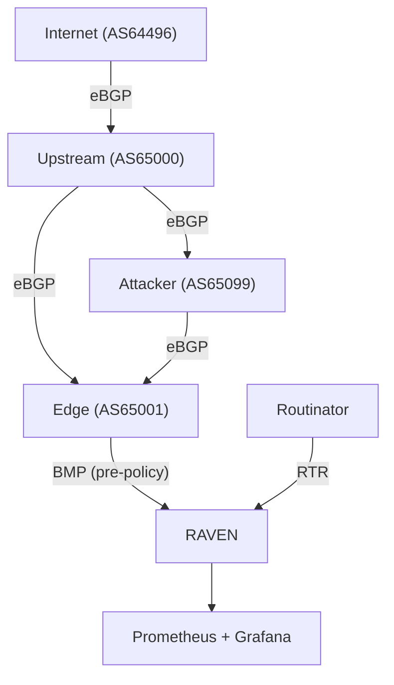

# Demo Lab Overview

RAVEN ships with a complete Containerlab topology that runs the full routing
security stack on your laptop. This is the same lab used for conference demos.

## What the Lab Gives You

- Four FRR routers simulating a real network topology (including an attacker node)
- Live BGP sessions with BMP streaming to RAVEN
- Routinator serving real RPKI data including ASPA objects
- Prometheus and Grafana with pre-built dashboards
- Scripted attack scenarios — IPv4/IPv6 origin hijack, route leak (ASPA), what-if simulation

## Topology

The lab topology consists of four FRR routers and RAVEN connected via
Containerlab:



| Node | ASN | Role |
|---|---|---|
| internet | AS64496 | Originates `2001:db8:2121::/48` (IPv6 demo prefix); used as the IPv4 origin-hijack source for `192.0.2.0/24` |
| upstream | AS65000 | Transit provider, sends post-policy BMP to RAVEN |
| edge | AS65001 | Edge router, sends pre-policy BMP to RAVEN |
| attacker | AS65099 | Peered with upstream and edge; used for stealthy hijack and IPv6 origin hijack |

Route queries without `--rib` show the
[default view](../getting-started/concepts.md#which-rib-to-monitor),
pre-policy Adj-RIB-In and Loc-RIB, so upstream's post-policy routes appear
only with `raven routes --rib adj-rib-in-post` (or `--rib post-policy`).
For Loc-RIB monitoring, see the separate [Loc-RIB Lab](loc-rib.md).

AS64496 is from RFC 5398's documentation/private range — chosen so the lab
never collides with real-world RPKI records. The route-leak scenario uses
real-world RPKI data: upstream (AS65000) re-originates `145.102.136.0/22`
(owned by AS1199 / SURFnet, with a real ROA) and prepends AS1199 in the
AS_PATH. AS1199's published ASPA lists AS1103 as its only authorized
provider, so the hop AS1199→AS65000 fires ASPA:Invalid and the route
lands in `path-suspect`.

## Prerequisites

- **Containerlab** — [install guide](https://containerlab.dev/install/)
- **Docker** — running and accessible without sudo (or use sudo)
- **Routinator** — native binary or Docker (see Installing Routinator below)
- **RAVEN** — built from source or installed via go install
- **Prometheus** — Docker container
- **Grafana** — Docker container

## Installing Routinator

### Docker

A Docker image is available at `nlnetlabs/routinator:latest`. Save the following as `~/.routinator.conf`:

```toml
repository-dir = "/home/routinator/.rpki-cache/repository"
rtr-listen = ["0.0.0.0:3323"]
http-listen = ["0.0.0.0:8323"]
disable-rsync = true
enable-aspa = true
```

Then start the container:

```bash
docker run -d --name routinator \
  -p 3323:3323 \
  -v ~/.routinator.conf:/home/routinator/.routinator.conf:ro \
  -v ~/.rpki-cache:/home/routinator/.rpki-cache \
  nlnetlabs/routinator:latest \
  server
```

### Native Binary

```bash
# Install via cargo
cargo install routinator

# Or download a pre-built binary from
# https://github.com/NLnetLabs/routinator/releases

# Create config
mkdir -p ~/.rpki-cache/repository
cat > ~/.routinator.conf << 'CONF'
repository-dir = "/home/YOUR_USER/.rpki-cache/repository"
rtr-listen = ["127.0.0.1:3323"]
http-listen = ["127.0.0.1:8323"]
disable-rsync = true
CONF

# Start Routinator (first run takes ~4 minutes to sync)
routinator server &
```

!!! warning
    Routinator takes approximately 4 minutes for a cold start while it
    downloads and validates the RPKI repository. A warm cache restart takes
    about 13 seconds. **Do not kill Routinator between demos** — the warm
    cache is essential for reliable demo startup.

## Quick Lab Start

From the RAVEN repository root:

```bash
bash lab/demo-master.sh setup
```

This command:

1. Deploys the Containerlab topology
2. Waits for FRR BGP sessions to converge
3. Verifies Routinator is running and synced
4. Starts RAVEN
5. Starts Prometheus and Grafana
6. Imports the Grafana dashboard
7. Runs a baseline check

The script reports each step as it goes; `✓ Routinator RTR ready` confirms
that Routinator is serving validated data. It then prints the route table
(`raven routes`) and finishes with these lines, which are fixed text in
`demo-master.sh`:

```text
✓ Setup complete.

  Grafana:    http://localhost:3000/d/raven-security-posture  (admin / raven123)
  Prometheus: http://localhost:9090
  RAVEN API:  http://localhost:11020
  Metrics:    http://localhost:9595/metrics

  Expected postures (baseline — 5 routes, path-suspect = 0):
    origin-only    → 100.64.0.0/24, 198.51.100.0/24, 203.0.113.0/24, 10.10.0.0/24
    unverified     → 10.99.99.0/24
    path-suspect   → (none at baseline)
```

To see RAVEN's own view of the RPKI data, check the `RPKI:` line of
`raven status`, or the `raven_rtr_vrp_count` and `raven_rtr_aspa_count`
metrics.

## Demo Commands Reference

```bash
bash lab/demo-master.sh setup         # Start everything
bash lab/demo-master.sh down          # Stop everything cleanly
bash lab/demo-master.sh baseline      # Show clean route table
bash lab/demo-master.sh hijack        # Inject IPv4 origin hijack
bash lab/demo-master.sh hijack-clean  # Withdraw the IPv4 hijack
bash lab/demo-master.sh hijack6       # Inject IPv6 origin hijack
bash lab/demo-master.sh unhijack6     # Withdraw the IPv6 hijack
bash lab/demo-master.sh leak          # Inject route leak (ASPA)
bash lab/demo-master.sh leak-clean    # Withdraw the route leak
bash lab/demo-master.sh whatif        # Run what-if simulator
bash lab/demo-master.sh recommend     # Run ASPA recommender
```

## Grafana Dashboard

Open [http://localhost:3000](http://localhost:3000) in your browser.

- Username: `admin`
- Password: `admin`

The Security Posture Overview dashboard updates in real time as you run
the attack scenarios.

## Stopping the Lab

```bash
bash lab/demo-master.sh down
```

This stops RAVEN, Prometheus, Grafana, and destroys the Containerlab topology
cleanly. Always use this rather than killing processes manually.
