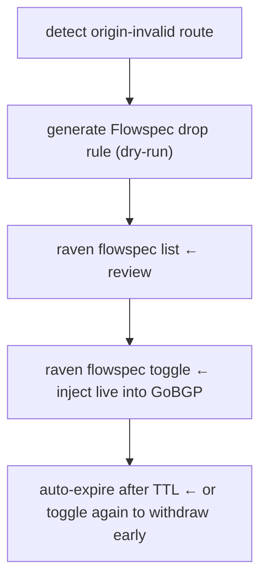

# Active Response

RAVEN's Phase 3 capabilities move beyond observation into automated response.
The Event Engine evaluates configurable rules on every posture change and
triggers actions: webhooks, logs, and Flowspec mitigation rules.

---

## Event Engine

The Event Engine runs continuously alongside the validation pipeline. On every
posture change it evaluates all configured rules and fires matching actions.

### Rule Structure

```yaml
events:
  rules:
    - name: "alert-origin-invalid"
      trigger:
        type: posture_change
        postures: ["origin-invalid"]
      cooldown: 60s
      actions:
        - type: log
          level: warn
        - type: webhook
          url: "https://hooks.example.com/raven"
        - type: flowspec
          dry_run: true
          ttl: 5m
```

**Trigger**: what causes the rule to fire. `posture_change` fires when a
route transitions to one of the listed postures. The trigger also fires for
new routes arriving with a matching posture.

**Cooldown**: minimum time between firings of the rule for the same route:
the same router, peer distinguisher, peer, prefix, ADD-PATH path ID and
RIB. Prevents alert storms during route flapping. A Go duration such as
`60s`; without one, the rule has no cooldown. Earlier
releases kept the cooldown per prefix and peer address, so an event in one
RIB, on one router or in one VRF suppressed the same prefix's event
elsewhere.

**One firing per RIB**: the Event Engine evaluates routes in every RIB
except Adj-RIB-Out. A router that exports both its pre-policy Adj-RIB-In
and its Loc-RIB reports a hijacked route in both, so a rule fires once for
each RIB, and each firing carries its `rib`. Add a [`rib`
trigger](#rib-trigger) to keep a rule to the RIBs you want alerts from.
A Flowspec action is injected once per prefix and action even when the rule
fires for several RIBs, because the Flowspec registry dedupes on that key;
the injected rule, and the approval webhook if one is configured, carry the
peer of whichever event came first, which for a Loc-RIB event is `0.0.0.0`.
To limit a rule to one RIB, add a `rib` trigger, but note that a router that
exports only its Loc-RIB then never matches `adj-rib-in-pre`.

**Actions**: what happens when the rule fires. Multiple actions can be
listed; they execute in order. If one action fails, subsequent actions
still run.

### Trigger Types

| Type | Required fields | Description |
|---|---|---|
| `posture` | `postures` | Route currently has one of the listed postures (steady-state) |
| `posture_change` | `postures` | Route posture transitions *to* one of the listed postures |
| `prefix` | `prefix` | Route prefix falls within (or equals) the configured supernet |
| `asn` | `asns` | Route involves one of the listed ASNs |
| `protected_asn` | `asns` | Origin-invalid route hijacks a prefix authorised for one of the listed ASNs |
| `cache_unhealthy` | - | RTR cache becomes unreachable |
| `rib` | `ribs` | Route is in one of the listed RIBs |
| `compound` | - | AND/OR composition of any of the above trigger types |

`posture` evaluates current state on every event; it fires even if the posture has not changed. `posture_change` fires only on transitions: when `old_posture != new_posture` and the new posture matches. Use `posture_change` for alerting (avoids re-firing on every update for a route that is already in a bad state); use `posture` inside compound triggers when you need to combine a steady-state check with another condition.

**`asn` trigger** - fires whenever a route's origin ASN (default) or any ASN in
its full AS path (`asn_match: path`) matches one in the `asns` list. Use this to
track routing events involving a specific network.

**`protected_asn` trigger** - fires when a route is `origin-invalid` and a
covering VRP names one of the listed ASNs as the authorised originator. This
detects prefix hijacks targeting prefixes you own: the hijacking route does not
contain your ASN in its path, but the RPKI record says only your ASN is allowed
to originate it.

<a id="rib-trigger"></a>
**`rib` trigger** - fires when the event's route is in one of the RIBs in
`ribs`: `adj-rib-in-pre` (or `pre-policy`), `adj-rib-in-post` (or
`post-policy`), `loc-rib`, `adj-rib-out-pre`, `adj-rib-out-post`. On its own
it matches every event of those RIBs, so use it inside a `compound` trigger
to keep another trigger to some RIBs. An empty `ribs` or an unknown RIB name
is a configuration error, and RAVEN does not start.

```yaml
- name: "alert-origin-invalid-loc-rib"
  trigger:
    type: compound
    operator: and
    triggers:
      - type: posture
        postures: ["origin-invalid"]
      - type: rib
        ribs: ["loc-rib"]
  cooldown: 60s
  actions:
    - type: log
      level: warn
```

This fires for `origin-invalid` routes your routers selected, once per
route, however many other RIBs report the same route. Expect it to fire on
some of your own routes too; see
[Internal routes show as Invalid](../troubleshooting.md#internal-routes-show-as-invalid).

### Compound Triggers

A compound trigger combines multiple sub-triggers with boolean AND or OR logic. Use it to narrow a broad trigger to a specific prefix scope, or to merge several independent conditions into a single rule.

```yaml
trigger:
  type: compound
  operator: and          # "and": all must match, "or": any must match
  triggers:
    - type: posture_change
      postures: ["origin-invalid"]
    - type: prefix
      prefix: "192.0.2.0/24"
```

This fires only when a route that falls within `192.0.2.0/24` transitions to `origin-invalid`. A hijack on an unrelated prefix leaves this rule silent.

**Operator semantics:**

| Operator | Fires when |
|---|---|
| `and` | Every sub-trigger matches (intersection) |
| `or` | At least one sub-trigger matches (union) |

Sub-triggers can themselves be compound; nesting is fully supported:

```yaml
trigger:
  type: compound
  operator: or
  triggers:
    - type: posture_change
      postures: ["origin-invalid"]
    - type: compound
      operator: and
      triggers:
        - type: posture_change
          postures: ["path-suspect"]
        - type: prefix
          prefix: "10.0.0.0/8"
```

Fires on any `origin-invalid` event, *or* when a `path-suspect` event lands within `10.0.0.0/8`.

#### Recipes

**Alert only on your own address space:**

```yaml
- name: "alert-own-prefix-hijack"
  trigger:
    type: compound
    operator: and
    triggers:
      - type: posture_change
        postures: ["origin-invalid"]
      - type: prefix
        prefix: "203.0.113.0/24"
  cooldown: 60s
  actions:
    - type: log
      level: error
    - type: webhook
      url: "https://hooks.example.com/critical"
```

**Fan-in: alert on route threat or RPKI cache failure under one rule:**

```yaml
- name: "alert-any-threat"
  trigger:
    type: compound
    operator: or
    triggers:
      - type: posture_change
        postures: ["origin-invalid", "path-suspect"]
      - type: cache_unhealthy
  cooldown: 30s
  actions:
    - type: webhook
      url: "https://hooks.example.com/raven"
```

**Scoped Flowspec: auto-mitigate only within a critical range:**

```yaml
- name: "mitigate-critical-range"
  trigger:
    type: compound
    operator: and
    triggers:
      - type: posture_change
        postures: ["origin-invalid"]
      - type: prefix
        prefix: "198.51.100.0/24"
  cooldown: 60s
  actions:
    - type: flowspec
      gobgp_address: "localhost:50051"
      dry_run: true
      ttl: 30m
      rule_action: drop
```

### Recommended Rules

**Alert on hijacks (origin-invalid):**

```yaml
- name: "alert-hijack"
  trigger:
    type: posture_change
    postures: ["origin-invalid"]
  cooldown: 60s
  actions:
    - type: log
      level: warn
    - type: webhook
      url: "https://your-pagerduty-or-slack-endpoint"
```

**Alert on route leaks (path-suspect):**

```yaml
- name: "alert-route-leak"
  trigger:
    type: posture_change
    postures: ["path-suspect"]
  cooldown: 60s
  actions:
    - type: log
      level: warn
    - type: webhook
      url: "https://your-pagerduty-or-slack-endpoint"
```

**Flowspec mitigation on hijacks:**

```yaml
- name: "mitigate-hijack"
  trigger:
    type: posture_change
    postures: ["origin-invalid"]
  cooldown: 60s
  actions:
    - type: flowspec
      gobgp_address: "localhost:50051"
      dry_run: true
      ttl: 1h
      rule_action: drop
      max_rules: 50
```

**Alert when any route involves a specific ASN (origin only):**

```yaml
- name: "track-as64496-origin"
  trigger:
    type: asn
    asns: [64496]
  cooldown: 300s
  actions:
    - type: log
      level: info
```

**Alert when any route traverses a specific ASN (full path):**

```yaml
- name: "track-as64496-transit"
  trigger:
    type: asn
    asns: [64496]
    asn_match: path
  cooldown: 300s
  actions:
    - type: webhook
      url: "https://your-endpoint"
```

**Alert when your own prefixes are hijacked (protected_asn):**

```yaml
- name: "alert-my-prefix-hijacked"
  trigger:
    type: protected_asn
    asns: [64511]
  cooldown: 60s
  actions:
    - type: log
      level: warn
    - type: webhook
      url: "https://your-pagerduty-or-slack-endpoint"
```

This rule fires only when an `origin-invalid` route covers a prefix for which
a VRP names your ASN as the sole authorised originator — a strong signal that
your prefix is being hijacked.

---

## Webhooks

The webhook action sends an HTTP POST to your endpoint when a rule fires.

### Payload Format

```json
{
  "id": "b65b80a6-1234-5678-abcd-ef0123456789",
  "timestamp": "2026-10-18T14:23:01Z",
  "type": "posture_change",
  "rule_name": "alert-my-prefix-hijacked",
  "router_id": "192.0.2.1",
  "prefix": "203.0.113.0/24",
  "peer_addr": "198.51.100.1",
  "peer_distinguisher": "",
  "rib": "adj-rib-in-pre",
  "peer_asn": 64500,
  "origin_asn": 64496,
  "protected_asns": [64511],
  "old_posture": "",
  "new_posture": "origin-invalid",
  "rov_state": "Invalid",
  "aspa_state": "Unknown",
  "cache_name": ""
}
```

`rule_name` identifies which rule fired the webhook. `router_id` is the
monitored router (its BMP source address). `protected_asns` lists the
ASNs named as authorised originators in VRPs that cover the affected prefix — only
present when covering VRPs exist.

`rib` is the route's RIB and `peer_distinguisher` the peer's VRF route
distinguisher, `""` for a peer in the global instance. Both are always
present. Because a rule fires once per RIB, use `rib` to tell the firings
for one route apart. For a Loc-RIB route, `peer_addr` is `0.0.0.0` and
`peer_asn` the router's own AS:

```json
{
  "id": "b65b80a6-1234-5678-abcd-ef0123456789",
  "timestamp": "2026-10-18T14:23:01Z",
  "type": "posture_change",
  "rule_name": "alert-origin-invalid-loc-rib",
  "router_id": "192.0.2.3",
  "prefix": "203.0.113.0/24",
  "peer_addr": "0.0.0.0",
  "peer_distinguisher": "",
  "rib": "loc-rib",
  "peer_asn": 64499,
  "origin_asn": 64511,
  "old_posture": "origin-only",
  "new_posture": "origin-invalid",
  "rov_state": "Invalid",
  "aspa_state": "Unknown",
  "cache_name": ""
}
```

The `log` action logs the route's `peer`, `peer_distinguisher` and `rib`
with each firing, for the same reason.

### HMAC Signing

Set `secret` in the webhook config to enable HMAC-SHA256 signing. RAVEN
adds an `X-RAVEN-Signature` header to every request:
X-RAVEN-Signature: sha256=<hex-digest>

The signature is computed over the raw JSON body. Verify it on your
webhook receiver to confirm the request is from RAVEN.

```yaml
actions:
  - type: webhook
    url: "https://hooks.example.com/raven"
    secret: "your-shared-secret"
    max_attempts: 3
    timeout: 5s
```

### Retry Behaviour

Failed webhook deliveries are retried with exponential backoff up to
`max_attempts` times. If all attempts fail, the event is logged to the
dead-letter log at warn level. RAVEN never blocks the event pipeline on
webhook failures.

### Integrations

The webhook payload is compatible with:

- **PagerDuty**: use the Events API v2 with a custom transformer
- **Slack**: use an incoming webhook URL; transform the payload with a small proxy function
- **ServiceNow**: POST to the Table API endpoint for your incident table
- **Alertmanager**: use a webhook receiver with a custom template

---

## Flowspec Lifecycle

The Flowspec action automates the full mitigation lifecycle:



### Prerequisites

Flowspec injection requires a GoBGP instance with gRPC enabled. In the
demo lab, a GoBGP sidecar container handles this. In production, point
`gobgp_address` at your GoBGP instance.

```yaml
- type: flowspec
  gobgp_address: "your-gobgp:50051"
  dry_run: true
  ttl: 1h
  rule_action: drop
  max_rules: 50
  reaper_interval: 30s
```

### Dry-run Mode

Always start with `dry_run: true`. Rules are tracked in RAVEN's registry
and logged but not injected into GoBGP. This lets you validate that the
correct rules are being generated before enabling live injection.

```bash
# Review generated rules
raven flowspec list

# Example output
KEY                            ACTION  DRY-RUN  TTL        INSERTED
192.0.2.0/24|drop              drop    yes      4m50s      2026-05-06 14:23:01
```

### Live Injection

Toggle a specific rule from dry-run to live:

```bash
raven flowspec toggle "192.0.2.0/24|drop"
```

RAVEN calls GoBGP's AddPath API. The rule propagates to any BGP peers
configured on the GoBGP instance. Verify with:

```bash
docker exec gobgp gobgp global rib -a ipv4-flowspec
```

Toggle again to withdraw:

```bash
raven flowspec toggle "192.0.2.0/24|drop"
```

### TTL and Auto-expiry

Every rule has a TTL (default: 1 hour). The reaper goroutine runs every
`reaper_interval` and withdraws rules whose TTL has expired. This ensures
Flowspec rules don't persist indefinitely if RAVEN restarts or the
operator forgets to withdraw manually.

### Approval Webhook

For human-in-the-loop automation, configure an approval webhook. RAVEN
POSTs the proposed rule and waits for a 200 response before injecting:

```yaml
- type: flowspec
  gobgp_address: "localhost:50051"
  dry_run: false
  approval_webhook: "https://change-mgmt.example.com/approve"
  ttl: 1h
```

The approval endpoint receives the same JSON payload as a regular webhook
plus a `proposed_rule` field. Return 200 to approve, any other status to
reject.

!!! warning
    Max rules (`max_rules`) is a hard cap. When the registry is full, new
    rules are dropped and logged. Set this conservatively: a runaway
    event loop generating hundreds of Flowspec rules is worse than missing
    a few.

---

## raven audit

`raven audit` generates a read-only security posture report for any router
or peer in your BMP feed. It summarises ROV/ASPA coverage, flags top
offending ASNs, and provides actionable recommendations.

```bash
# Audit a specific router by peer address
raven audit --router 10.0.0.1

# JSON output for automation
raven audit --router 10.0.0.1 --format json

# Markdown output for incident reports
raven audit --router 10.0.0.1 --format markdown
```

### Example Output

```text
Router: 10.0.0.1
Total Routes: 6
ROV Coverage:  83.3%
ASPA Coverage: 0.0%
POSTURE          COUNT
origin-only      3   (50%)
unverified       1   (17%)
origin-invalid   2   (33%)
TOP OFFENDERS
AS64496   1 route   origin-invalid   192.0.2.0/24
AS65001   1 route   origin-invalid   10.10.0.0/24
RECOMMENDATIONS

2 origin-invalid routes: run raven what-if --reject-invalid
ASPA coverage 0%: register ASPA objects at your RIR
Consider enabling reject-invalid after reviewing what-if output
```


### Automation

Pipe audit output to your ticketing or reporting pipeline:

```bash
# Weekly cron job
0 9 * * 1 raven audit --router 10.0.0.1 --format json \
  | curl -s -X POST https://your-api/security-report \
         -H "Content-Type: application/json" -d @-
```

---

## Warm-start Persistence

On clean shutdown, RAVEN saves the route table and RPKI cache to `routes.snap` and `rpki.snap` in the snapshot directory. On restart, it restores from the snapshots before reconnecting to BMP and RTR, eliminating the 30–90 second blind window of a cold start.

Enable in config:

```yaml
persistence:
  enabled: true
  snapshot_dir: "/var/lib/raven/snapshots"   # directory, not a file
  stale_eviction_timeout: 5m
```

Restored routes are marked stale. If BMP doesn't refresh a route within `stale_eviction_timeout`, it is evicted. This prevents stale routes from persisting if the topology changed during the downtime.

!!! note
    The snapshot uses JSON serialisation. When buf/protoc become available
    in your build environment, swap to protobuf for faster save/restore
    on large route tables. The interface is unchanged.
